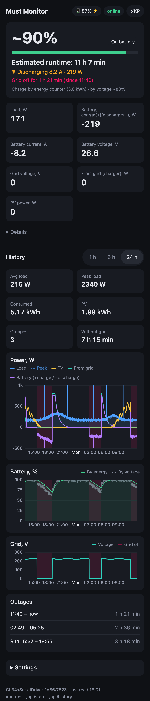

# must-monitor

Monitor a MUST inverter with a spare Android phone or TV box. You don't need the vendor Wi-Fi dongle or a cloud account.

**Who it's for:** you have a MUST inverter (PV18 / HBP18 etc.) but no Wi-Fi module, or you'd rather not depend on the vendor cloud. If you have an old Android phone, tablet or TV box lying around, connect it to the inverter's USB port and it becomes a local monitoring server:

- a web dashboard on your home network: battery, load, PV, grid, 24h charts and outage log;
- Telegram notifications when grid power goes out and comes back, with battery state and estimated runtime;
- 24h history stored on the device itself, with no cloud or sign-up;
- Prometheus metrics if you want Grafana and long-term storage.

<p>
  
  
</p>

The screenshots above use demo data. The dashboard UI is in Ukrainian.

## Requirements

- Android 8.0+ phone, tablet or TV box.
- The inverter's USB cable (CH340 USB-serial; CP210x / PL2303 / FTDI cables should also work, but the app won't auto-open when they are plugged in).
- An OTG adapter for a phone. A TV box has full-size USB ports, so no adapter is needed.
- Power the device (and ideally the router) from the inverter output, so it keeps working during outages.

## Supported models

| Status | Models |
| --- | --- |
| Tested | **HBP18 (HBP1800)** |
| Expected to work (same PV1800-family Modbus map: registers 25201+ / 15201+) | PV18 / PV1800 (VPM, VHM, VPK), PH1800, EP1800 |
| Unknown | Other MUST lines (PV19, PV3xxx, EP20/EP30, PH3000/5000…). They may use a different protocol or register map. |

To check an unverified unit, open `http://DEVICE_IP:8080/api/raw?addr=25201&count=10`. If it returns sensible numbers, the register map most likely matches.

Connection: Modbus RTU over USB, 19200 8N1, slave address 4.

## Features

### Dashboard

Open `http://DEVICE_IP:8080/` from any browser on the same network. The app also shows it on its own screen. If the device has no WebView (some cheap TV boxes), the app shows the URL to open instead.

- **Live values**, refreshed every 5 s: state of charge, charging/discharging current and power, load, grid voltage and import, PV, output, temperatures.
- **History** (1h / 6h / 24h) with these stats: average and peak load, consumed kWh, PV kWh, number of outages, time without grid.
- **Charts** for power (load, peak, PV, grid import, battery), battery state of charge, and grid voltage. Outages are shaded, and hover or tap shows the values at that moment on all charts.
- **Outage log** with start, end and duration.

### Telegram notifications

1. Create a bot with **@BotFather** (`/newbot`) and copy the token.
2. Send any message to the bot, or add it to a group.
3. On the dashboard, open **Налаштування** (Settings). Paste the token, press **Знайти chat id** (Find chat id), then **Зберегти** (Save) and **Тест** (Test).

The bot then posts:

- 🔴 **Grid lost** with the time, how long the grid was on, battery %, voltage, load and estimated runtime.
- 🟢 **Grid restored** with the time, how long it was out, and battery %.

Grid detection uses hysteresis: on above 170 V, off below 150 V. A change must hold for 3 consecutive polls (~15 s), so voltage dips don't cause spam. The internet often goes down together with the power, so messages are queued and retried every 30 s for up to 24 h. Each message keeps the original event time.

### Battery

- **Charge / discharge.** The battery power and current registers are signed, but MUST doesn't document which sign means charging. On HBP18, negative means charging, and that is the default. The app also learns the sign during the first outage with no PV, when the battery can only be discharging. You can override it in Settings (**Напрям струму батареї**, battery current direction).
- **State of charge, two ways.**
  - *By energy (main value).* The app counts energy in and out of the battery, using 95% charge efficiency and the capacity from Settings (**Ємність батареї**, default 3000 Wh). It recalibrates to 100% after the battery has sat full for ~5 minutes (voltage at the top, charge current near zero). The value is saved every minute and survives restarts. **Скинути лічильник заряду** (reset charge counter) re-seeds it from voltage.
  - *By voltage.* An 8S LiFePO4 curve. This is only rough under load or while charging. It is shown for comparison and used as the starting point of the energy counter.
- **Runtime estimate** = state of charge × capacity ÷ current load.

### History storage

- One point every 30 s, averaged over the 5 s polls. Peak load is stored separately.
- Kept for 24 h in the app's private storage (`files/history.csv`). Grid on/off events go in `files/events.csv`.
- Survives app restarts, updates and reboots. Uninstalling the app deletes it.

## Setup

### Phone

1. Install the APK, connect the inverter via OTG, and tick **"use by default"** for Must Monitor in the USB permission dialog.
2. When asked, allow the app to ignore battery optimizations.
3. Go to Settings → Apps → Must Monitor → Battery → **Unrestricted**.
4. Reserve a static IP for the phone on your router.

### Android TV box

1. Install the APK (via `adb install` or a file manager). The app appears in the TV launcher.
2. Plug the inverter cable into a USB port and accept the USB permission dialog with the remote (tick "use by default").
3. On many Chinese firmwares (X96, H96, some Xiaomi), allow **Autostart** for the app and disable sleep / screensaver. Then reboot and check that the dashboard comes back.
4. Prefer Ethernet, and reserve a static IP.

The monitoring service starts automatically after boot and after an app update.

## Build

You need JDK 17 and the Android SDK (platform 34, build-tools). Point Gradle at the SDK with `local.properties` (not committed):

```properties
sdk.dir=/path/to/android-sdk
```

or set `ANDROID_HOME`. Then build:

```sh
./gradlew :app:assembleDebug
```

The APK is written to `app/build/outputs/apk/debug/app-debug.apk`. Install it with:

```sh
adb install -r app/build/outputs/apk/debug/app-debug.apk
```

or copy the APK to the device and open it (allow installs from unknown sources). For a TV box, run `adb connect BOX_IP:5555` first.

### Releases (CI)

Pushing a `v*` tag builds the APK on GitHub Actions and attaches it to a GitHub release:

```sh
git tag v0.2.0 && git push origin v0.2.0
```

The workflow can also be started manually from the Actions tab. In that case the APK is only uploaded as a build artifact.

> **Signing:** Android only installs an update over an existing app if both are signed with the same key. Debug builds from CI and from your machine use different keys. To switch between them, uninstall first, which deletes settings and history.

### Remote updates

Use adb over a VPN (e.g. Tailscale or WireGuard) to the device:

```sh
adb connect 100.x.y.z:5555
adb install -r must-monitor-v0.2.0.apk
```

The service restarts by itself after the update. Never expose adb directly to the internet.

## HTTP API (port 8080)

| Endpoint | Description |
| --- | --- |
| `GET /` | Web dashboard |
| `GET /metrics` | Prometheus metrics |
| `GET /api/state` | Current values, inverter state, grid state, battery capacity |
| `GET /api/history` | Last 24 h: `{keys, rows}`, one row per 30 s |
| `GET /api/events` | Grid transitions `[ts_ms, on]` and current grid state |
| `GET /api/settings` | Settings. The bot token is never returned, only its last 4 characters. |
| `POST /api/settings` | Form fields: `token`, `chatId`, `enabled`, `batterySign` (`0` auto / `1` / `-1`), `batteryWh`, `socReset=1` |
| `POST /api/telegram/test` | Send a test message (uses form `token` / `chatId`, or the saved ones) |
| `POST /api/telegram/detect` | List chats that wrote to the bot (via `getUpdates`) |
| `GET /api/raw?addr=25201&count=10` | Raw holding-register read, for exploring registers |

> The HTTP server has no authentication. Anyone on your network can view the dashboard and change settings. Keep it on a trusted LAN, or behind a VPN.

## Prometheus

```yaml
- job_name: must
  scrape_interval: 15s
  static_configs:
    - targets: ["DEVICE_IP:8080"]
```

Main metrics:

| Metric | Meaning |
| --- | --- |
| `must_up` | 1 if the inverter answered within the last 30 s |
| `must_grid_present` | Debounced grid state (same as used for notifications) |
| `must_load_power_watts`, `must_load_percent` | Load |
| `must_grid_voltage_volts`, `must_grid_import_watts` | Grid voltage, power taken from the grid |
| `must_grid_power_watts` | Raw grid power register (negative = import) |
| `must_battery_voltage_volts` | Battery voltage |
| `must_battery_charge_power_watts`, `must_battery_charge_current_amps` | Battery flow, positive = charging |
| `must_battery_power_watts`, `must_battery_current_amps` | Raw battery registers (sign per inverter) |
| `must_battery_soc_energy_percent` | State of charge by energy counting |
| `must_battery_soc_estimate_percent` | State of charge estimated from voltage |
| `must_pv_power_watts`, `must_pv_voltage_volts`, `must_pv_charger_current_amps` | PV |
| `must_*_energy_kwh_total` | Inverter energy counters |
| `must_work_state`, `must_work_state_info{state}` | Inverter mode (OffGrid, Bypass, …) |

## Notes and limitations

- Load and inverter power registers are read as signed. Around grid switchover the inverter briefly reports small negative values, which are clamped to 0. Values above 15 kW are dropped as glitches.
- In **Bypass** mode the inverter may report 0 W load, because power flows past it. Consumed kWh can then be under-counted while the grid is on.
- PV/charger registers (15201+) are read separately. If the unit doesn't answer them, `chargerError` in `/api/state` shows why.
- The state of charge is not read from the BMS. Both values are estimates, and the energy-based one is accurate only after its first recalibration at 100%.
