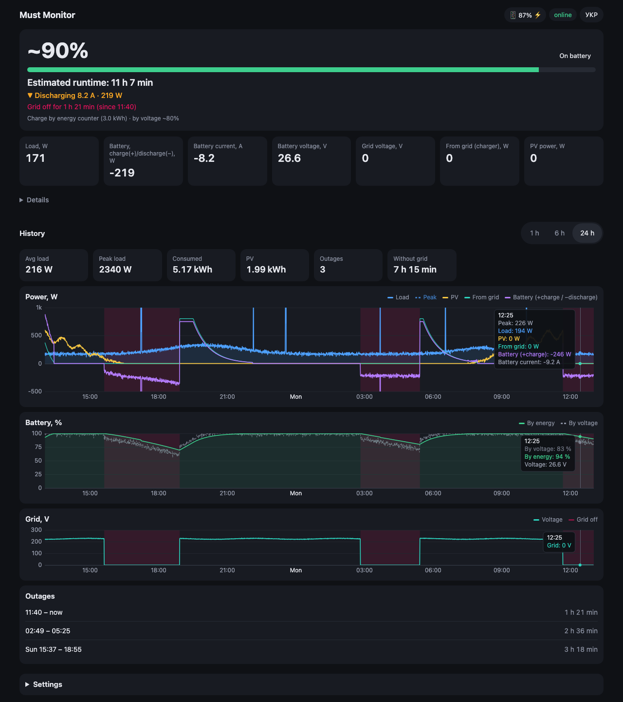

# must-monitor

Monitor a MUST inverter with a spare Android phone or TV box. You don't need the vendor Wi-Fi dongle or a cloud account.

**Who it's for:** you have a MUST inverter (PV18 / HBP18 etc.) but no Wi-Fi module, or you'd rather not depend on the vendor cloud. If you have an old Android phone, tablet or TV box lying around, connect it to the inverter's USB port and it becomes a local monitoring server:

- a web dashboard on your home network: battery, load, PV, grid, 24h charts and outage log;
- Telegram notifications when grid power goes out and comes back, with battery state and estimated runtime;
- 24h history stored on the device itself, with no cloud or sign-up;
- Prometheus metrics if you want Grafana and long-term storage.

<p>
  
  
</p>

The screenshots above use demo data.

**Languages:** the dashboard is available in **Ukrainian and English**. It picks the browser language on first open (Ukrainian for `uk`/`ru`, English otherwise); the **EN / УКР** button in the header switches it, and the choice is remembered per browser. Telegram messages have their own language setting. The phone notification and the fallback screen follow the system language.

## Requirements

- Android 8.0+ phone, tablet or TV box.
- The inverter's USB cable (CH340 USB-serial; CP210x / PL2303 / FTDI cables should also work, but the app won't auto-open when they are plugged in).
- An OTG adapter for a phone. A TV box has full-size USB ports, so no adapter is needed.
- Power the device (and ideally the router) from the inverter output, so it keeps working during outages.

## Supported models

| Status | Models |
| --- | --- |
| Tested | **HBP18 (HBP1800)** |
| Expected to work (same PV1800-family Modbus map: registers 25201+ / 15201+) | PV18 / PV1800 (VPM, VHM, VPK), PH1800, EP1800 |
| Unknown | Other MUST lines (PV19, PV3xxx, EP20/EP30, PH3000/5000…). They may use a different protocol or register map. |

To check an unverified unit, open `http://DEVICE_IP:8080/api/raw?addr=25201&count=10`. If it returns sensible numbers, the register map most likely matches.

Connection: Modbus RTU over USB, 19200 8N1, slave address 4.

## Features

### Dashboard

Open `http://DEVICE_IP:8080/` from any browser on the same network. The app also shows it on its own screen. If the device has no WebView (some cheap TV boxes), the app shows the URL to open instead.

- **At a glance**: state of charge, estimated runtime (or time to full while charging), charging/discharging current and power, how long the grid has been on/off, and the battery of the phone running the app.
- **Status that survives switchover glitches**: online / updating… / inverter not responding, with the age of the last reading; one missed poll doesn't flip it to offline. Stale values are dimmed.
- **Live values**, refreshed every 5 s; secondary ones (PV voltage, output frequency, temperatures…) are folded under **Details**.
- **History** (1h / 6h / 24h) with time-weighted stats: average and peak load, consumed kWh, PV kWh, number of outages, time without grid. Only measured time is counted.
- **Charts** for power, battery state of charge and grid voltage. Outages are shaded red; periods with no data (monitoring was off) are hatched grey; spikes don't flatten the scale. Hover or tap shows the values on all charts; arrow keys work too (TV remote).
- **Outage log** with start, end and duration. An outage that overlaps a data gap is marked as approximate.
- Polling pauses while the tab is hidden; after the first load only new history rows are fetched.

### Telegram notifications

1. Create a bot with **@BotFather** (`/newbot`) and copy the token.
2. Send any message to the bot, or add it to a group.
3. On the dashboard, open **Settings**. Paste the token, press **Find chat id**, choose the **message language** (Ukrainian or English), then **Save** and **Test**.

The bot then posts:

- 🔴 **Grid lost** with the time, how long the grid was on, battery %, voltage, load and estimated runtime.
- 🟢 **Grid restored** with the time, how long it was out, and battery %.
- If monitoring was not running when the change happened (app stopped, inverter off, USB unplugged), the message says the change was only *noticed* at that time and shows no duration, instead of reporting a wrong one.
- ⚠️ **Inverter not responding** for 3+ minutes, and ✅ when it is back (on by default, can be turned off). While the inverter is silent, grid notifications cannot work.
- 🪫 **Phone battery low** (optional, threshold 10% by default): when the phone running the app is low and not charging, e.g. it is powered from the inverter output and the inverter shut down. And 🔌 when it charges again.

Grid detection uses hysteresis: on above 170 V, off below 150 V. A change must hold for 3 consecutive polls (~15 s), so voltage dips don't cause spam. The internet often goes down together with the power, so messages are queued and retried every 30 s for up to 24 h. The queue is stored in a file, so it also survives an app restart. Each message keeps the original event time.

### Battery

- **Charge / discharge.** The battery power and current registers are signed, but MUST doesn't document which sign means charging. On HBP18, negative means charging, and that is the default. The app also learns the sign during the first outage with no PV, when the battery can only be discharging. You can override it in Settings (**Battery current direction**).
- **State of charge, two ways.**
  - *By energy (main value).* The app counts energy in and out of the battery, using 95% charge efficiency and the capacity from Settings (**Capacity**, default 3000 Wh). It recalibrates to 100% after the battery has held the **full voltage** (Settings, default 27.0 V; set it a bit below your inverter's float voltage) for ~5 minutes with almost no current. The value is saved every minute and survives restarts. After a long stop it is re-seeded from voltage only if the battery is near rest (voltage reads high while charging and low under load). On a fresh install it waits for rest or for a full battery before showing a value. **Reset charge counter** re-seeds it from voltage.
  - *By voltage.* An 8S LiFePO4 curve. This is only rough under load or while charging. It is shown for comparison and used as the starting point of the energy counter.
- **Runtime estimate** = (state of charge − 10% reserve) × capacity ÷ average battery discharge power over the last 10 minutes. The discharge power is used rather than the load because the inverter consumes power itself: on an HBP18, 100 W of load drains ~143 W from the battery.
- **Time to full** while charging = remaining capacity ÷ charge power.

### History storage

- One point every 30 s, averaged over the 5 s polls. Peak load is stored separately.
- Kept for 24 h in the app's private storage (`files/history.csv`). Grid on/off events go in `files/events.csv`.
- Survives app restarts, updates and reboots. Uninstalling the app deletes it.
- **Wrong clock after a reboot.** Cheap TV boxes often boot with a wrong date and can't sync it without internet. If the system time is earlier than the last time known to be correct, the app approximates the time (last known time + uptime) until the clock syncs. Timestamps are then slightly early, and messages are marked with "≈".

### Backup and restore

Uninstalling an Android app deletes its private data (settings, history, event log). To survive a reinstall or a move to another phone:

- **Automatic backup**: every hour (and ~1 minute after settings change) the app writes `Download/MustMonitor/must-monitor-backup.json` to the device's shared storage. That folder is **not** deleted with the app. On Android 10+ no permission is needed; on Android 8–9 the app asks for storage permission once.
- **Manual**: Settings → Backup → **Download backup** saves the same file through the browser.
- **Restore**: Settings → Backup → **Restore from file…** and pick the file (on the phone it is in Download/MustMonitor). Settings are replaced; history and outages are merged with what is already there, nothing is lost. After a fresh install the dashboard shows a hint pointing to this.

Android 11+ doesn't let a reinstalled app silently read a file left by its previous installation, so restoring is one manual step. After a reinstall, the next auto backup is written as `must-monitor-backup (1).json` next to the old one; both can be restored from.

The backup contains the Telegram bot token in plain text. Don't share the file.

> Most "lost settings" come from a forced uninstall: Android only updates an app in place when the new APK is signed with the same key. Builds from the same machine (or the same keystore) update in place and keep all data.

## Setup

### Phone

1. Install the APK, connect the inverter via OTG, and tick **"use by default"** for Must Monitor in the USB permission dialog.
2. When asked, allow the app to ignore battery optimizations.
3. Go to Settings → Apps → Must Monitor → Battery → **Unrestricted**.
4. Reserve a static IP for the phone on your router.

### Android TV box

1. Install the APK (via `adb install` or a file manager). The app appears in the TV launcher.
2. Plug the inverter cable into a USB port and accept the USB permission dialog with the remote (tick "use by default").
3. On many Chinese firmwares (X96, H96, some Xiaomi), allow **Autostart** for the app and disable sleep / screensaver. Then reboot and check that the dashboard comes back.
4. Prefer Ethernet, and reserve a static IP.

The monitoring service starts automatically after boot and after an app update.

## Build

You need JDK 17 and the Android SDK (platform 34, build-tools). Point Gradle at the SDK with `local.properties` (not committed):

```properties
sdk.dir=/path/to/android-sdk
```

or set `ANDROID_HOME`. Then build:

```sh
./gradlew :app:assembleDebug
```

The APK is written to `app/build/outputs/apk/debug/app-debug.apk`. Install it with:

```sh
adb install -r app/build/outputs/apk/debug/app-debug.apk
```

or copy the APK to the device and open it (allow installs from unknown sources). For a TV box, run `adb connect BOX_IP:5555` first.

### Releases (CI)

Pushing a `v*` tag builds the APK on GitHub Actions and attaches it to a GitHub release:

```sh
git tag v0.2.0 && git push origin v0.2.0
```

The version name comes from the tag (`v0.2.0` → `0.2.0`) and the version code from the workflow run number, so versions always go up. Note that CI currently signs with a fresh debug key on every run, so one CI release can't be installed over another without uninstalling first (see Signing below).

> **Signing:** Android only installs an update over an existing app if both are signed with the same key. Debug builds from CI and from your machine use different keys. To switch between them, uninstall first, which deletes settings and history.

### Remote updates

Use adb over a VPN (e.g. Tailscale or WireGuard) to the device:

```sh
adb connect 100.x.y.z:5555
adb install -r must-monitor-v0.2.0.apk
```

The service restarts by itself after the update. Never expose adb directly to the internet.

## HTTP API (port 8080)

| Endpoint | Description |
| --- | --- |
| `GET /` | Web dashboard |
| `GET /metrics` | Prometheus metrics |
| `GET /api/state` | Current values, inverter and grid state, `now` (device time), SoC source, phone battery, startup errors |
| `GET /api/history?since=TS` | Last 24 h: `{keys, rows}`, one row per 30 s. `since` (unix seconds) returns only newer rows. |
| `GET /api/events` | Grid transitions `[ts_ms, on]` and current grid state |
| `GET /api/settings` | Settings. The bot token is never returned, only its last 4 characters. |
| `POST /api/settings` | Form fields: `token`, `clearToken=1`, `chatId`, `enabled`, `tgLang` (`uk` / `en`), `inverterOfflineAlert`, `phoneLowAlert`, `phoneLowPercent`, `batterySign` (`0` auto / `1` / `-1`), `batteryWh`, `batteryFullVolts`, `socReset=1`. All fields are validated before anything is saved. Optional `lang` (`uk` / `en`) selects the language of error messages. |
| `POST /api/telegram/test` | Send a test message (uses form `token` / `chatId`, or the saved ones) |
| `POST /api/telegram/detect` | List chats that wrote to the bot (via `getUpdates`) |
| `GET /api/raw?addr=25201&count=10` | Raw holding-register read, for exploring registers |
| `GET /api/backup` | Download a backup (JSON: settings incl. token, charge counter, events, history) |
| `POST /api/restore` | Restore from a backup (JSON body). Settings replaced, history and events merged. |

> The HTTP server has no login: anyone on your network can view the dashboard and change settings. Keep it on a trusted LAN, or behind a VPN.
> To stop *other websites* from driving it through a browser on your network, all POSTs require the header `X-Must-Monitor: 1` (the dashboard sends it; cross-site pages can't), no CORS headers are sent, and settings, raw-register, backup and Telegram endpoints only answer when the `Host` is an IP address, `localhost`, or a local name (`*.local`, `*.lan`, `*.home`, `*.internal`, a name without dots). Scripted example:
> `curl -H 'X-Must-Monitor: 1' -d batteryWh=3000 http://DEVICE_IP:8080/api/settings`

## Prometheus

```yaml
- job_name: must
  scrape_interval: 15s
  static_configs:
    - targets: ["DEVICE_IP:8080"]
```

Main metrics:

| Metric | Meaning |
| --- | --- |
| `must_up` | 1 if the inverter answered within the last 30 s |
| `must_grid_present` | Debounced grid state (same as used for notifications) |
| `must_load_power_watts`, `must_load_percent` | Load, always positive (see Notes on the register sign) |
| `must_load_power_unmeasured` | 1 if the unit reported 0 W in Bypass while load current was flowing |
| `must_grid_voltage_volts`, `must_grid_import_watts` | Grid voltage; total power taken from the grid (pass-through to the load + charger) |
| `must_grid_power_watts` | Raw grid power register: the inverter's net figure (charger minus load), not the total |
| `must_inverter_power_watts` | Raw inverter bridge power: positive = feeding the load, negative = charging the battery from the grid |
| `must_battery_voltage_volts` | Battery voltage |
| `must_battery_charge_power_watts`, `must_battery_charge_current_amps` | Battery flow, positive = charging |
| `must_battery_power_watts`, `must_battery_current_amps` | Raw battery registers (sign per inverter) |
| `must_battery_soc_percent` | Best state of charge (energy-based if known, else voltage) |
| `must_battery_soc_energy_percent` | State of charge by energy counting |
| `must_battery_runtime_seconds`, `must_battery_time_to_full_seconds` | Estimates (present while discharging / charging) |
| `must_device_battery_percent`, `must_device_charging` | Battery of the phone running the app |
| `must_battery_soc_estimate_percent` | State of charge estimated from voltage |
| `must_pv_power_watts`, `must_pv_voltage_volts`, `must_pv_charger_current_amps` | PV |
| `must_*_energy_kwh_total` | Inverter energy counters |
| `must_work_state`, `must_work_state_info{state}` | Inverter mode (OffGrid, Bypass, …) |

## Notes and limitations

- Power registers are signed by direction. Measured on an HBP18 in **Bypass** while charging from the grid:

  | Register | On battery | Bypass + charging |
  | --- | --- | --- |
  | 25215 load power | +401 | −526 |
  | 25214 grid power | 0 | −541 (= −1066 + 526) |
  | 25213 inverter power | +356 | −1066 (bridge works as the charger) |
  | 25273 battery power | +441 | −988 (negative = charging) |

  A second reading with no load gave inverter −1100, grid −1118. So in Bypass the load is the magnitude of the (negative) load register, the grid register is charger minus load, and the power actually taken from the grid is charger + load (here ≈ 1.6 kW). Off-grid, small negative load values appear only for a moment around switchover and are clamped to 0. Power values above 15 kW are dropped as glitches.
- While charging, the voltage-based state of charge reads ~100% (charging voltage is high), while the energy counter keeps the real value. Use the energy-based value.
- PV/charger registers (15201+) are read separately. If the unit doesn't answer them, `chargerError` in `/api/state` shows why.
- The state of charge is not read from the BMS. Both values are estimates, and the energy-based one is accurate only after its first recalibration at 100%.
